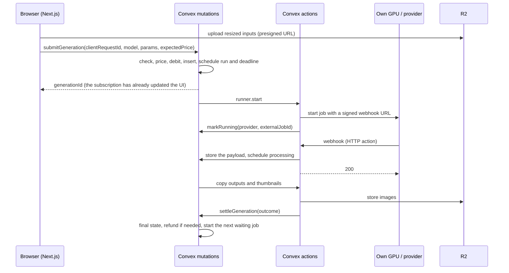
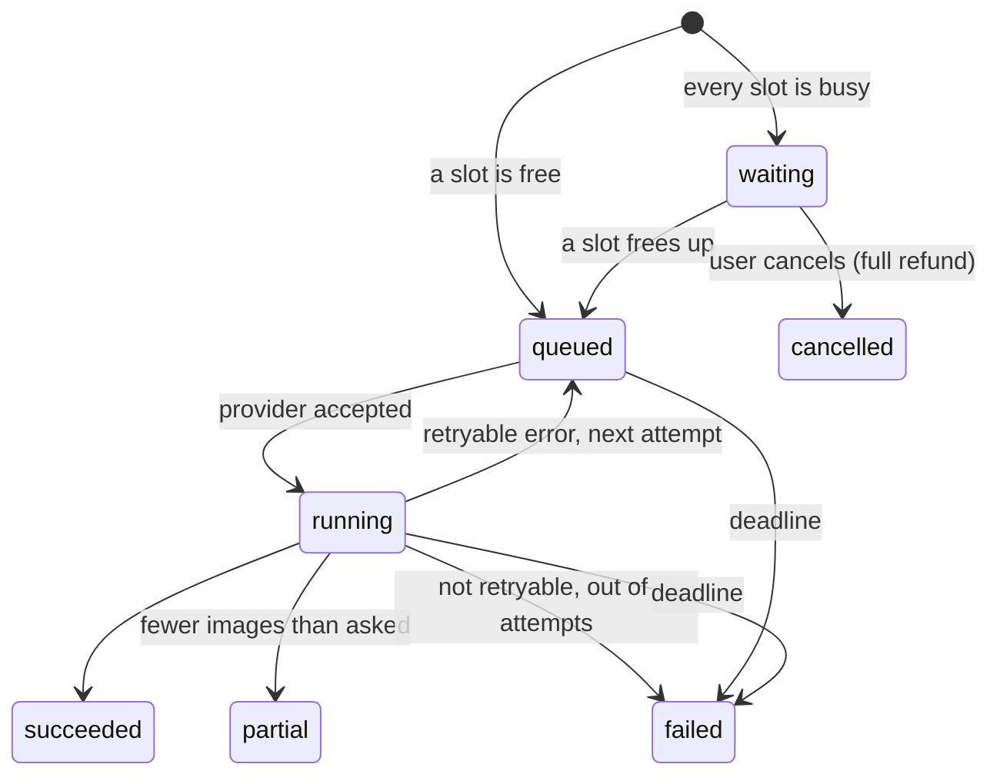

# Credit-based image generation: build plan

This is my plan for the feature in the Rendair case brief, written for the teammate who would build it. The brief asks for one function in real code. I wrote `submitGeneration` ([`convex/generations.ts`](convex/generations.ts)) and also `settleGeneration` ([`convex/settle.ts`](convex/settle.ts)), because submit schedules it and the refund rule lives there. Both deploy to Convex and have tests.

```bash
npm install
npm test               # 49 tests: pricing, submit, settle, cancel, ledger
npm run typecheck
npm run convex:local   # pushes to a local Convex backend, no account needed
```

## In short

- A workspace owns one credit balance shared by its members and by every tool. Renewals, extra seats and top-ups add to it, and nothing expires.
- Submit is one transaction. It checks the price the user saw, takes the credits, and schedules both the run and a deadline check. A generation can't keep credits without finishing or being refunded.
- Plan limits come from Rendair's pricing: renders at once (1 / 4 / 4) and jobs in the background (4 / 8 / 12). Jobs over the first limit wait in line; Pro and up go first when providers are busy.
- For models our GPUs serve, they take the job first and external providers take the overflow. Each provider has its own concurrency limit.
- Every credit movement is a ledger entry with a unique reference, so a repeated webhook can't grant or refund twice.

## 0. Assumptions

These follow rendair.ai/pricing where it says something, and are my choices where it doesn't.

1. Credits belong to the workspace. Members share them, and so do all tools ("credits are shared across every app"). The free plan gets Starter's limits.
2. Renewals add the plan's credits to what is left. Extra seats add 500 each. Top-ups can be bought any time. Since nothing expires, one balance is enough; if plan credits ever expire, the ledger gets lots with expiry dates.
3. Credits are whole numbers and the server sets every price. Text-to-image is free on Rendair, so a price of 0 is valid: `text-to-image` goes through the same limits and writes no ledger entry.
4. A user hasn't "got a result" until a finished image is stored in our bucket. Provider errors, safety refusals, timeouts and a failed copy all refund. "I don't like the image" goes to support, who can add an `adjustment`.
5. A generation asks for 1 to 4 images, priced per image. Images that don't arrive are refunded one by one.
6. A generation that hasn't finished 5 minutes after it leaves the waiting line has failed, and time spent waiting for a free provider counts. That is twice the slowest normal run (150 s). A result that arrives later is discarded.
7. Uploads are JPEG, PNG or WebP, at most 4 per generation, resized in the browser before upload.

## 1. How it works



The page subscribes to the workspace's generations and balance, so every step above shows up without polling.

## 2. Decisions

| Decision | Chosen | Considered | Why |
|---|---|---|---|
| Backend | Convex | Postgres + a job queue + a realtime layer | Mutations are serializable transactions, queries are live, and a function scheduled from a mutation runs only if the mutation commits. One system covers all three. I haven't run Convex in production; this follows its docs, and the code deploys to a local Convex backend. |
| Who owns credits | The workspace | The user | Rendair's plans have members and a shared pool. |
| Balance | A cached `creditBalance` plus an append-only ledger, written together | Summing the ledger on every read | Reading the balance stays cheap and the ledger is the audit trail. A nightly job checks that they agree. |
| When to charge | Debit at submit, refund on failure | Charge on success | Two tabs can't spend the same credits, and the user sees the cost right away. |
| Deadline | Scheduled by the submit mutation | Scheduled by the runner action | Actions run at most once. If the runner crashes, a deadline it was supposed to schedule never exists. One scheduled by the mutation is guaranteed to run. |
| Routing | Own GPU first, external overflow, per-provider concurrency | One fixed provider per model | Our GPUs cost less per job, and external providers add capacity when ours are full or down. |
| Prices | Typed definitions in code, shared with the client | A pricing table with an admin UI | Price changes get review and tests; a model can still be switched off without a deploy. |
| Storage | A private Cloudflare R2 bucket behind a Worker that checks the viewer's workspace | Convex file storage, public URLs | No egress fees for images viewed many times. Rendair promises that files stay private. |

## 3. Data model

Full schema: [`convex/schema.ts`](convex/schema.ts).

| Table | Key fields | Indexes |
|---|---|---|
| `workspaces` | `plan`, `creditBalance`, `isInternal?`, `limitOverrides?` | |
| `users` | `tokenIdentifier`, `workspaceId` | `by_token` |
| `creditLedger` | `workspaceId`, `userId?`, `amount`, `kind`, `generationId?`, `ref` | `by_workspace`, `by_ref` |
| `generations` | `workspaceId`, `userId`, `clientRequestId`, `modelId`, `params`, `priceCredits`, `imagesRequested`, `priority`, `status`, `attempt`, `provider?`, `externalJobId?`, `error?`, `outputs`, `costUsd?`, `deadlineAt?` | `by_user_request`, `by_workspace_status`, `by_status_deadline` |
| `uploads` | `workspaceId`, `userId`, `r2Key`, `contentType`, `sizeBytes` | `by_workspace` |
| `modelFlags` | `key` (`model:render`, `provider:own-gpu`), `state` (`on`, `internal`, `off`) | `by_key` |

Ledger kinds are `plan_renewal`, `seat_grant`, `top_up`, `generation_debit`, `generation_refund`, `chargeback` and `adjustment`. `ref` is unique by construction: a Stripe invoice or checkout session id, or `generation:<id>:debit` / `:refund`.



Rules that always hold. The first two are checked after every Convex test; the third has its own tests (a repeated webhook, a late result, a second cancel):

- Each workspace's `creditBalance` equals the sum of its ledger entries. Spending never takes it below zero; only a chargeback can.
- A generation has at most one debit and at most one refund.
- Final states (`succeeded`, `partial`, `failed`, `cancelled`) never change.

## 4. Models and pricing

Each model is one definition in [`shared/models/catalog.ts`](shared/models/catalog.ts): providers in order of preference, whether a prompt is required, how many input images it takes, its median duration, a Zod schema for its parameters, and a price per image. One schema drives validation, price and the params form, and `pricingVersion` is stored on each generation. The three examples follow Rendair's rates: text-to-image is free, a render costs about 1 credit per image and an upscale 5:

| Model | Parameters | Credits per image |
|---|---|---|
| `render` (fal, then Replicate) | quality, resolution, aspect ratio, count 1 to 4; one to four input images | standard 1, high 2; plus 0 / 1 / 3 for 1k / 2k / 4k |
| `upscale` (own GPU, then fal) | factor; exactly one input image, no prompt | 2x: 5, 4x: 10 |
| `text-to-image` (fal, then Replicate) | aspect ratio, count 1 to 4; no input images | 0 |

The client sends the price it showed as `expectedPriceCredits`. If the server's price differs, submit fails with `PRICE_CHANGED` and the new price, so nobody pays more than the button said.

## 5. Flows

### Submit

[`submitGeneration`](convex/generations.ts) does all of this in one transaction:

1. Load the member and their workspace. A repeated `clientRequestId` returns the existing generation, so a double click or a network retry doesn't charge twice.
2. Check that the model and at least one of its providers are on for this workspace. A flag can be `internal`, for rollout to our own team.
3. Validate params, prompt and input images (each upload must belong to the workspace), then compare prices.
4. Check the balance. A parallel submit reads the same balance, so Convex reruns one of them.
5. Start any waiting jobs that fit in free slots. If a promotion was ever missed, this repairs the line.
6. Admit the job: `queued` if a render slot is free and nobody is waiting, `waiting` if the background limit allows, otherwise `TOO_MANY_PENDING`.
7. Insert it, debit the ledger, and for a queued job schedule `runner.start` and a timed-out `settleGeneration` at `deadlineAt`.

### Run

The runner tries the model's providers in order. Own GPU comes first for the models it serves, and the next provider takes the job when the GPUs are full or failing. Each provider has a concurrency limit (GPU count, or the provider's rate limit). When every provider is full, queued jobs wait in a dispatch order of plan priority, then age, using an index on `priority` and creation time (build step 4). That is Rendair's "your jobs start first when it is busy". Time in this line counts toward the deadline, because the user is waiting either way; the "time waiting" dashboard shows it before it turns into timeouts. Each attempt gets its own timeout of 150 s, the slowest normal run, so one stuck provider doesn't use up the whole deadline. When less than that is left, the runner doesn't start another attempt: it settles the job as `TIMED_OUT` right away, so we don't pay a provider for an image we would discard. It creates signed read URLs for the inputs, starts the job, and records it with `markRunning`.

### Webhook and settle

The webhook URL is `/webhooks/<provider>?generation=<id>&attempt=<n>&sig=<HMAC>`. The HTTP action checks the signature, stores the raw payload through a mutation (a `webhookEvents` table, build step 2), schedules processing and answers 200, so nothing is lost if processing fails. Processing copies the outputs into R2, makes a 512 px thumbnail, and calls [`settleGeneration`](convex/settle.ts):

- A final generation, or an outcome from an old attempt, is ignored. Duplicate and late webhooks change nothing.
- A retryable error before the deadline moves the job back to `queued` with `attempt + 1`, at most 3 attempts. A result with no images counts as the retryable `NO_OUTPUT`.
- Otherwise it stores outputs and cost, refunds missing images through `by_ref` (at most once), and starts the oldest waiting job.
- At the deadline the same function fails the job if it is still queued or running, and refunds it. The runner also cancels the job at the provider where its API allows.

### Billing

Stripe webhooks become ledger entries, each keyed by Stripe's own id so a redelivery is a no-op. `invoice.paid` becomes `plan_renewal` (keyed by the invoice) plus `seat_grant` for extra seats (keyed by the invoice line). `checkout.session.completed` becomes `top_up`. A refund or dispute becomes a `chargeback` for the credits bought. If they were already spent, the balance goes negative, which blocks new submits until it's back above the price, and the reconcile job flags it.

## 6. Frontend and UX

The generate page (`app/(app)/generate/page.tsx`) is a server component that preloads the balance and the first page of generations with `preloadQuery`; the form and gallery are client components on `usePreloadedQuery` and `usePaginatedQuery`.

Before submit, the params form is generated from the model's schema and the button reads "Generate · 3 credits", priced with the same `quote` as the server. Images are resized to the model's maximum input size in the browser and start uploading as soon as they are dropped. With too few credits the button is disabled and a "Buy credits" link sits next to it.

After submit, an optimistic update adds the card and lowers the balance before the server answers. A waiting card shows its place in line ("2nd, starts in about 30 s", from the model's median) and a Cancel button that refunds right away. A running card shows elapsed time and a progress bar based on the median, since most providers don't report progress. When a job finishes in a hidden tab, the tab title shows a count and an optional browser notification fires.

A failed card says what happened in plain words from the error table below, shows "3 credits refunded", and offers Retry with the same settings. A finished image offers Upscale, Use as input, and Variations with the same seed for consistent views. All of these are new generations with their own price. The gallery shows thumbnails, opens the original on click, and filters by status and board.

## 7. What a teammate needs

The provider adapter, in [`shared/providers/types.ts`](shared/providers/types.ts):

```ts
interface ProviderAdapter {
  id: "fal" | "replicate" | "own-gpu";
  maxConcurrentJobs: number;
  start(job: StartJob): Promise<{ externalJobId: string }>;
  parseWebhook(body: unknown): ProviderResult;
  poll(externalJobId: string): Promise<ProviderResult>;
  cancel?(externalJobId: string): Promise<void>;
}
```

Generation errors, in [`shared/providers/errors.ts`](shared/providers/errors.ts). The UI shows the message; settle reads `retryable`.

| Code | Retry | Code | Retry |
|---|---|---|---|
| `PROVIDER_ERROR` | yes | `STORAGE_FAILED` | yes |
| `PROVIDER_BUSY` | yes | `SAFETY_REFUSAL` | no |
| `RATE_LIMITED` | yes | `INVALID_INPUT` | no |
| `NO_OUTPUT` | yes | `TIMED_OUT` | no |

Submit errors are `ConvexError`s with a `code` and the data the UI needs, for example `{ code: "PRICE_CHANGED", priceCredits: 3 }` ([`convex/lib/errors.ts`](convex/lib/errors.ts)).

`generations.listMine` returns pages of `{ _id, status, modelId, prompt, priceCredits, imagesRequested, outputs: { thumbUrl, url }[], error?, queuePosition?, _creationTime }`. The URLs point at the Worker in front of R2.

### Folder structure

```
app/(app)/generate/            page.tsx, _components/ (ModelPicker, ParamsForm, Dropzone,
                               GenerateButton, GenerationGrid, GenerationCard, BalanceBadge)
convex/
  schema.ts                    in this repo
  generations.ts               submitGeneration, cancelGeneration (in repo); listMine
  settle.ts                    settleGeneration (in repo)
  lib/                         auth, credits, queue, errors (in repo)
  runner.ts                    start, markRunning, poll (stub in repo)
  uploads.ts  http.ts  billing.ts  crons.ts
shared/
  models/  plans.ts  limits.ts  providers/types.ts, errors.ts (in repo); providers/<adapter>.ts
tests/                         in repo
```

### Build order

Each step ships behind a model flag set to `internal` first.

1. Schema, ledger, submit, settle, cancel (this repo).
2. Runner, webhook and R2 copy with one external provider; a fake adapter for tests.
3. Generate page and gallery with live updates, optimistic cards and error messages.
4. Own-GPU adapter, routing, per-provider limits, priority and fallback.
5. Uploads with resizing, thumbnails, notifications, and the actions on finished images.
6. Stripe webhooks into the ledger, dashboards, alerts and the nightly reconcile. Then flags go to `on`.

## 8. Testing

The repo has 49 tests (`npm test`): pricing tables, each check in submit and cancel, and settle's success, partial, empty, failure, retry, stale-attempt, deadline and promotion cases. Every Convex test ends by checking that each workspace's balance equals its ledger and isn't negative, and that no generation has two debits or two refunds. To make sure the tests catch real bugs, I removed 14 rules one at a time, among them dedupe by `ref`, the deadline schedule, the self-repair in submit, the stale-attempt check, idempotent submit and the empty-result retry, and a test failed each time.

What it doesn't cover: convex-test runs mutations one at a time, so two racing submits are Convex's guarantee, not shown here. Next would be a script against a dev deployment that fires parallel submits and settles and then compares the ledger, plus the runner and webhook tested with the fake adapter.

## 9. In production

- Dashboards: generations by status, model and provider; p50 and p95 time to result; time waiting; retry, fallback and refund rates; provider cost (`costUsd`) against credits charged.
- Alerts: a provider under 90% success for 10 minutes (the runner skips it automatically, and someone is paged); any generation open past its deadline; any reconcile mismatch, which pages right away.
- Nightly reconcile: balance against ledger for each workspace, and negative balances.
- Structured logs carry the generation id from submit to webhook; errors go to Sentry.
- Deploys: Vercel for Next.js; Convex dev, preview (one per pull request) and production deployments; an R2 bucket per environment; provider keys and the webhook secret as Convex environment variables. A daily job deletes R2 objects nothing references.

## 10. The critical function

The brief asked for one function. I chose [`submitGeneration`](convex/generations.ts) because every rule of the feature meets there: idempotency, server-side pricing, the shared balance, plan limits, flags, and the debit committed together with the run and the deadline. A bug there charges people twice or lets a workspace spend credits it doesn't have, and every later step trusts what submit wrote.

The money can still leak after submit, in the async part, so [`settleGeneration`](convex/settle.ts) is in the repo too. It is the only way out of an open state, it ignores anything stale, and it refunds at most once.

## 11. Left out, and questions for you

Not in this version: video (same flow with a different median and price), credit expiry, team admin and per-member spending limits, cancelling a running job, a moderation check before submit, and an admin refund screen.

Questions the pricing page doesn't answer:

1. Do the members included in a plan (2 on Pro, 5 on Studio Pro) add credits, or only extra seats?
2. What happens to rolled-over credits on a downgrade or cancellation?
3. After a chargeback on spent credits, do you block the workspace or absorb the loss?

## About this repo

- `convex/_generated` comes from `npm run convex:local`, which pushes the schema and functions to a local Convex backend (`CONVEX_AGENT_MODE=anonymous`, no account).
- `convex/runner.ts` is a stub that throws, so the scheduled call typechecks. One test uses that: the runner crashes and the deadline still refunds.
