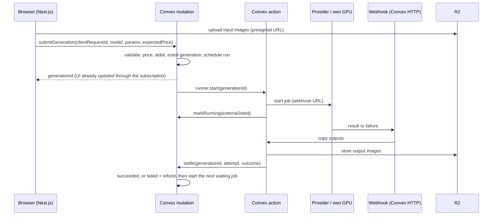
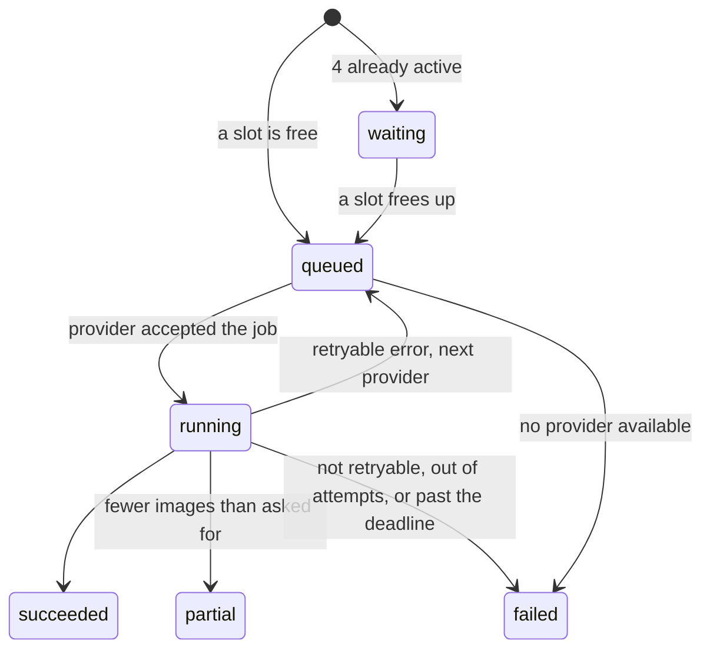

# Credit-based image generation: build plan

This is my plan for the feature in the Rendair case brief, written for the teammate who would build it. The plan is this README. The function I think matters most, `submitGeneration`, is real code in [`convex/generations.ts`](convex/generations.ts), with the pricing it depends on in [`shared/models/`](shared/models) and tests next to both.

```bash
npm install
npm test           # 27 tests: pricing tables and every rule in submitGeneration
npm run typecheck
```

## 0. Assumptions

The brief leaves these open on purpose. I picked one answer for each; changing any of them doesn't change the architecture.

1. Credits belong to a user. Team pools can come later; they only change who owns the balance.
2. Credits are whole numbers, and the server computes every price. The client shows a preview from the same code.
3. One generation asks for 1 to 4 images. The price is per image, and images that don't come back are refunded.
4. "A result they didn't get" means we didn't store a finished image. Provider errors, timeouts, safety refusals and a failed copy to our storage all count, and all refund. "I don't like the image" is a support case; support can add an `adjustment` entry to the ledger.
5. Buying credits already exists. The Stripe webhook adds a `purchase` entry to the same ledger described here.
6. A user can have 4 generations running and 20 more waiting. This protects provider rate limits and our GPUs. The numbers are placeholders that plans can change later.
7. A generation that hasn't finished 5 minutes after it starts has failed. That is twice the slowest normal run. A result that arrives after that is ignored.
8. Input images are uploaded before submit: at most 4 per generation, 20 MB each, JPEG, PNG or WebP.

## 1. How it works

The user picks a model and its parameters and sees the exact price on the Generate button. Submit is one transaction: it checks everything, takes the credits, creates the generation and schedules the work. A background action sends the job to the first healthy provider. When the provider calls back, a second transaction finishes the generation, and if it failed, the same transaction gives the credits back. The page subscribes to the user's generations and balance, so every change appears on screen without polling.



## 2. Decisions and what I considered

| Decision | Chosen | Considered | Why |
|---|---|---|---|
| Backend and database | Convex | Postgres (Neon or Supabase) with a job queue (Inngest, Trigger.dev) and a realtime layer (SSE, Supabase Realtime) | Mutations are serializable transactions, so the balance check and the debit can't race. Queries are live subscriptions, which covers "updating live" with no extra code. A function scheduled from a mutation only runs if the mutation commits, so the database, the queue and the realtime layer are one system. The cost is weaker SQL reporting, so usage data goes to an analytics store. I haven't run Convex in production; this follows its docs. |
| Where the balance lives | A `creditBalance` field on the user plus an append-only ledger, written in the same mutation | Summing the ledger on every read; one row per credit | Reading the balance stays cheap and the ledger is the audit trail. A nightly job checks that they agree. |
| When to charge | Debit at submit, refund on failure | Charge only on success; a separate "reserved" balance | Debiting first means two tabs can't spend the same credits, and the user sees the cost right away. A reserved balance adds a state without changing what the user sees. |
| Where prices live | Typed model definitions in code, shared by client and server, plus a kill switch in the database | A pricing table with an admin UI | Price changes go through review and tests. The urgent case, turning a model or provider off, needs no deploy. An admin UI can come once prices change often. |
| Getting the result | Provider webhook, with a watchdog that polls as a fallback | An action that polls until the job is done | An action that polls holds a worker for up to 150 seconds per job. The watchdog covers webhooks that never arrive. |
| Storage | Cloudflare R2 | Convex file storage, S3 | Generated images get viewed many times, and R2 has no egress fees. It speaks the S3 API and supports presigned uploads. |
| Providers | An ordered list per model, one adapter per provider | One provider per model | A fallback keeps generations working through an outage, and the adapter keeps each provider's quirks out of the core flow. |

## 3. Data model

The full schema with validators is in [`convex/schema.ts`](convex/schema.ts).

| Table | Fields | Indexes |
|---|---|---|
| `users` | `tokenIdentifier`, `creditBalance` | `by_token` |
| `creditLedger` | `userId`, `amount` (signed), `kind` (`purchase`, `generation_debit`, `generation_refund`, `adjustment`), `generationId?`, `ref` | `by_user`, `by_generation_kind` |
| `uploads` | `userId`, `r2Key`, `contentType`, `sizeBytes` | `by_user` |
| `generations` | `userId`, `clientRequestId`, `modelId`, `pricingVersion`, `params`, `prompt`, `inputUploadIds`, `imagesRequested`, `priceCredits`, `status`, `attempt`, `provider?`, `externalJobId?`, `error?`, `outputs`, `startedAt?`, `finishedAt?`, `deadlineAt?` | `by_user`, `by_user_request`, `by_user_status`, `by_external`, `by_status_deadline` |
| `modelFlags` | `key` (`model:photoreal`, `provider:fal`), `enabled`, `reason?` | `by_key` |

Every index exists for a query: `by_user_request` makes submit idempotent, `by_user_status` counts open generations, `by_external` finds a generation from a webhook, `by_status_deadline` feeds the watchdog sweep, and `by_generation_kind` makes the refund happen at most once.

A generation moves through these states. `succeeded`, `partial` and `failed` are final.



Three rules hold at all times, and the tests check the first after every case:

- For every user, `creditBalance >= 0` and `creditBalance` equals the sum of their ledger entries.
- A generation has exactly one `generation_debit` and at most one `generation_refund`.
- Only `settle` moves a generation into a final state, and nothing moves it out.

## 4. Models and pricing

Each model is one definition in [`shared/models/catalog.ts`](shared/models/catalog.ts): an id, its providers in order of preference, how many input images it takes, its typical duration, a Zod schema for its parameters, and a price per image. The repo has two example models with different parameters, providers and input rules:

| Model | Parameters | Credits per image |
|---|---|---|
| `photoreal` (fal, then Replicate) | quality, resolution, aspect ratio, count | draft 2, standard 4, high 8; plus 0 / 2 / 6 for 1k / 2k / 4k |
| `sketch-render` (own GPU) | style, sketch strength, resolution, count; needs one input image | 3 at 1k, 5 at 2k |

`model.quote(params)` validates the parameters, fills in defaults and returns the price. The params form in the UI is generated from the same schema, so adding a model doesn't need new form code. The client sends the price it showed as `expectedPriceCredits`. If the server's price is different, for example because prices changed after the page loaded, submit fails with `PRICE_CHANGED` and returns the new price, so the user never pays more than the button said. `pricingVersion` is stored on each generation so old ones can be explained later.

## 5. Flows

### Submit

`submitGeneration` runs these steps in one transaction. Section 11 explains why this is the critical function.

1. Find the user from the auth identity.
2. If this user already has a generation with this `clientRequestId`, return it. A double click or a network retry doesn't charge twice.
3. Check that the model exists and that the model and at least one of its providers are switched on.
4. Validate the parameters, the prompt and the input images. Each upload must belong to this user.
5. Compute the price and compare it with `expectedPriceCredits`.
6. Check the balance.
7. Count the user's open generations. With fewer than 4 active and nobody waiting, the new one is `queued`. With fewer than 24 open in total, it is `waiting`. Otherwise it fails with `TOO_MANY_PENDING`.
8. Insert the generation, lower the balance, write the debit to the ledger, and schedule `runner.start` if it is `queued`.

### Run

The action loads the generation, picks the first provider whose flag is on, creates signed read URLs for the input images, and starts the job with a webhook URL that carries the generation id, the attempt number and an HMAC. It records the provider's job id through `markRunning`, which only accepts a `queued` generation, and schedules the watchdog for the deadline.

### Settle

The webhook checks the signature, schedules an action and answers 200 at once, so the provider never waits on our upload. The action copies the outputs into R2 and calls `settle`. `settle` exits without changes if the generation is already final or if the attempt number is old, so duplicate webhooks, late webhooks and a provider we already gave up on change nothing. On success it stores the outputs. On partial success it refunds the missing images (`priceCredits / imagesRequested` each). On failure it refunds everything, and a refund only happens if `by_generation_kind` shows none yet. In the same transaction it promotes the user's oldest `waiting` generation to `queued`, gives it a deadline and schedules its run.

### Retry and fallback

Retryable errors (5xx, capacity, rate limits) put the generation back to `queued` with `attempt + 1` and the next provider: at most 3 attempts, and only before the deadline. Errors that won't change on retry, like a safety refusal or a bad input, fail and refund immediately.

### Watchdog

Each run schedules one, and a cron sweeps `by_status_deadline` every minute in case a scheduled function was lost. If a generation is still running past its deadline, the watchdog asks the provider once. If the result is ready it settles it; otherwise it fails the generation, refunds, and cancels the job where the provider's API allows it.

### Uploads

An action returns a presigned PUT URL and a key. The browser uploads straight to R2. A second action checks the object's size and type with a HEAD request and only then records it in `uploads`. Submit accepts upload ids, never raw URLs.

## 6. Frontend and UX

The page is `app/(app)/generate/page.tsx`. A server component renders the layout and preloads the balance and the first page of generations with `preloadQuery`, so the first paint already has data. The form and the gallery are client components on `usePreloadedQuery` and `usePaginatedQuery`.

Model cards show the lowest price ("from 4 credits"), and the params form below them is generated from the model's schema. Uploads start as soon as files are dropped, so they have usually finished by the time the user clicks Generate.

The button reads "Generate · 8 credits" and updates as parameters change, using the same `quote` as the server. Without enough credits it is disabled, with a "Buy credits" link next to it.

To make it feel fast, the mutation is wrapped in an optimistic update: a placeholder card appears and the balance drops before the server answers. Cards then show elapsed time and a progress bar based on the model's typical duration, since most providers don't report progress.

A failed card says what went wrong in plain words ("The provider rejected this prompt", "This took too long and was stopped"), shows "8 credits refunded", and has a Retry button that keeps the same settings. Each error code from the server maps to one message.

The gallery lists newest first, loads more on scroll, and filters by status. Output images are served from R2's CDN domain under keys with a random part.

## 7. Folder structure

```
app/(app)/generate/
  page.tsx
  _components/  ModelPicker  ParamsForm  PromptInput  ImageDropzone
                GenerateButton  GenerationGrid  GenerationCard  BalanceBadge
convex/
  schema.ts
  generations.ts           submitGeneration, listMine, get
  generationsInternal.ts   markRunning, settle, requeue, startNextWaiting
  runner.ts                start, watchdog, sweep (actions)
  credits.ts               refund, grant, reconcile
  uploads.ts               createUploadUrl, finishUpload
  http.ts                  provider and Stripe webhooks
  crons.ts
  lib/                     auth, errors
shared/
  models/                  definitions, parameter schemas, quote()
  providers/               adapter interface, one file per provider, own GPU included
  limits.ts
```

Of this tree, the repo contains the schema, `generations.ts` with `submitGeneration` only, `lib/`, `shared/models/`, `shared/limits.ts` and the tests.

## 8. Infrastructure and deployment

- Next.js on Vercel. Convex Cloud with dev, preview (one per pull request) and production deployments. One R2 bucket per environment.
- Provider API keys and the webhook HMAC secret are Convex environment variables.
- Our own GPUs sit behind an HTTPS endpoint with the same contract as an external provider: start a job, call our webhook when done. Scaling the GPU pool is out of scope here.
- Rollout: each model ships behind its flag, to internal accounts first, then to everyone. Any model or provider can be turned off in `modelFlags` without a deploy.
- A daily job deletes R2 objects that no generation or upload references, such as outputs copied twice because of a duplicate webhook.

## 9. Testing

What this repo tests (`npm test`):

- Pricing as tables: parameters in, credits out, for both models, plus parameters that must be rejected.
- `submitGeneration` with [convex-test](https://github.com/get-convex/convex-test): the debit and the ledger entry, a repeated `clientRequestId`, a stale price, a short balance, spending down to zero, the 4 active / 24 open limits, the waiting line keeping its order, another user's upload, a missing input image, unknown parameters, switched-off models and providers, an empty prompt and a caller without an account.
- Every test ends by checking that the balance equals the ledger sum.
- I checked that the tests catch real bugs by removing the idempotency check and the waiting-line rule one at a time. The matching test failed each time.

What it doesn't test: convex-test runs mutations one at a time, so it can't show two submits racing. That guarantee comes from Convex's transactions. In the real project I'd add a script for a dev deployment that fires parallel submits and settles and then checks the ledger.

Next to add with the rest of the feature: `settle` with a fake provider adapter that can succeed, fail, time out or call back twice (duplicate and late webhooks, partial refunds, the deadline), and an end-to-end smoke test against that fake provider on every preview deployment.

## 10. Knowing it works in production

Dashboards show generations by status, model and provider, the success rate, p50 and p95 time from submit to done, time spent waiting, retry, fallback and refund rates, and provider cost against credits charged.

Alerts fire when a provider stays under 90% success for 10 minutes (switch it off and page someone), when any generation is still running past its deadline, and on any reconcile mismatch. The last one pages right away, because it means a balance is wrong.

A nightly reconcile compares each user's balance with their ledger sum, and looks for debits whose generation never reached a final state and for refunds without a failed or partial generation.

Logs are structured and carry the generation id on every line from submit to webhook. Errors from the browser and from actions go to Sentry.

## 11. The critical function

[`submitGeneration`](convex/generations.ts) is where money moves, and every rule of the feature meets there: idempotency, server-side pricing, the balance check, the concurrency limit, and the debit, generation and scheduled run committing together. A bug in the runner or the webhook can be retried. A bug here charges users twice or lets them spend credits they don't have. `settle` came second; its main job is refunding at most once, and the final-state check plus the refund lookup cover that.

Every check that only reads runs before the first write. A thrown error rolls back the whole mutation anyway, but this order keeps the function easy to follow. Errors are `ConvexError`s with a `code` and the data the UI needs, such as the current price for `PRICE_CHANGED`.

The user document and the open-generation counts are read inside the transaction. A second submit from another tab reads the same values, so Convex reruns one of them against the new balance. Scheduling the run inside the mutation means there is never a debit without a job, or a job without a debit.

## 12. Left out, and what I'd ask you

Not in this version: video, team credit pools, credit expiry, priority by plan, cancelling a running generation, a moderation check before submit, and an admin refund screen.

Questions whose answers would change the plan:

1. Should a team's members share one credit balance? If yes, `creditBalance` moves to a workspace, and with many members submitting at once that document needs sharding.
2. Do credits expire, for example monthly plan credits? Then the ledger needs lots with expiry dates, spent oldest first.
3. When a user complains about an image they did get, what does support usually do today?

## About this repo

- `convex/_generated` was written by hand to match what `npx convex codegen` produces, because codegen needs a Convex deployment. Running `npx convex dev` replaces it.
- `convex/runner.ts` is a stub so the scheduled call typechecks. The runner is planned in section 5.
